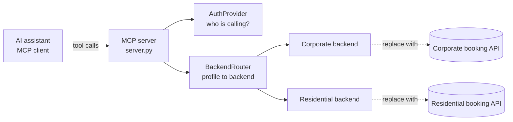

# Architecture

## Overview

Each tool call follows the same path:

1. The tool asks `AuthProvider` for the current user.
2. `BackendRouter` picks the backend for that user's profile.
3. The backend validates the request against its own rules and tenant, then acts.
4. A `BookingError` is converted to a tool error whose message tells the model what to do next.

## Why a router

Different customers often run different booking systems with different rules. Giving the assistant one tool set per system multiplies the tool list and invites wrong calls. Routing behind one tool set keeps the model's job simple and moves the differences to code you control.

## Tool design choices

| Choice | Reason |
|---|---|
| Few tools with clear names | Smaller tool lists are easier for models to use correctly |
| `whoami` returns the rules | The model can plan within limits instead of discovering them by failing |
| Identity is never a tool argument | The model cannot choose to act as someone else |
| Times need a UTC offset, on a quarter-hour boundary | Removes time-zone ambiguity and keeps availability maths simple |
| Typed, structured outputs | Clients and models get predictable fields |
| Errors have a code and a next step | The model can recover without guessing |
| Cancel is idempotent | Safe to retry after a timeout |
| Annotations on tools | Clients can distinguish read-only, write and destructive tools |

## Concurrency

Tool functions are synchronous, and the SDK runs them on worker threads. The in-memory backend guards its state with a lock, and the conflict check and the insert happen in one critical section, so two simultaneous requests cannot both book the same slot. A real backend must provide the same guarantee, usually with a database constraint or transaction.

## Time handling

Booking rules are evaluated in the backend's local time zone, so "07:00 to 20:00" means the same thing all year, including across daylight saving changes. Intervals are half-open: a booking from 10:00 to 11:00 does not conflict with one from 11:00 to 12:00.

## Testing approach

- **Backend tests** exercise the rules directly with an injectable clock, so "today" is fixed.
- **Server tests** connect an in-memory MCP client to the server and call tools as an assistant would, including error cases.
- A manual smoke test over stdio (see [connecting](connecting.md)) confirms the packaged server starts and answers.
